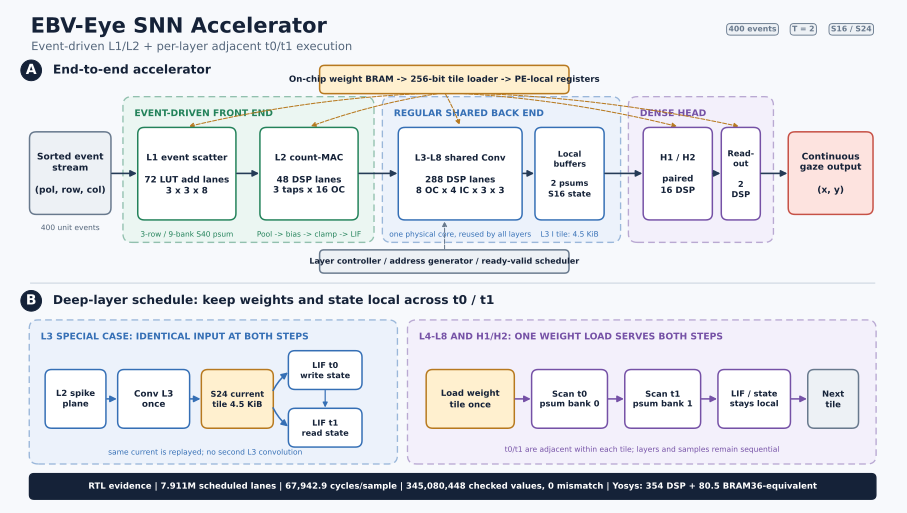
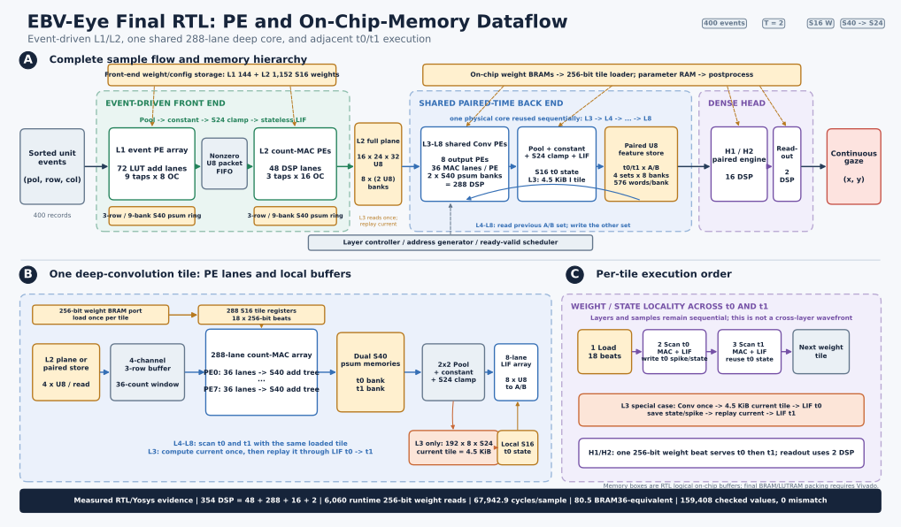

# EBV-Eye SNN Hardware

这个仓库保存 EBV-Eye 连续注视回归 SNN 的硬件交付件，供导师阅读、复核和继续研究。
建议先读[导师硬件进展汇报](docs/hardware/07_advisor_hardware_progress.md)：报告从任务、
400 事件输入和模型结构讲起，随后完整说明最终数据流、定点精度、三种硬件组织对照、
RTL 正确性、AUP-ZU3 资源映射和已有工作的性能定位。



下面的细化图进一步展开最终RTL中的PE阵列、逻辑片上存储、A/B特征回写和
每个权重tile内的双时间步执行顺序。



## 项目对象

EBV-Eye 由朝向眼睛的事件相机产生异步事件。每个推理样本连续取得 400 个 ROI 事件，
经 2×2 坐标缩减后等价为 `2×96×128` 的 ON/OFF 整数计数图，网络直接输出屏幕连续
坐标 `(x, y)`。同一位置允许堆叠多个事件，因此输入不是二值图。

SNN 包含八个 3×3 卷积脉冲层、两个脉冲全连接层和一个连续读出层，共 96,792 个参数。
同一完整 400 事件表示重复为 `t0/t1` 两步；L1/L2 不保存跨步膜状态，L3 到 H2 保存
状态。当前最终硬件采用：

1. L1 直接消费 400 个单位事件，以 72 个 LUT 加法 lane 做稀疏散射；
2. L2 仅消费 L1 的非零 U8 MultiSpike 包，以 48 个 DSP 做计数乘权重；
3. L3～L8 共用一个 288-DSP 卷积核心，每层内相邻执行 `t0/t1`；
4. H1/H2 共用 16-DSP 线性引擎，readout 用 2 个 DSP 输出连续坐标。

## 已完成结果

- 48 个正式模型、54,105 个 test 输入完成 16 位定点评估：Pursuit 为
  `0.823945° -> 0.825481°`，Saccade 连续回归为 `1.325509° -> 1.326037°`。
- 三个 seed、426 个 validation 样本的软件位精确稀疏回放检查
  `345,080,448` 个中间值，失配为 0。
- seed2022 validation 样本 0 的最终整网 RTL 检查 `159,408` 个值，失配为 0，
  完成时间为 67,929 拍。
- 最终组织相对稠密扫描基线将 scheduled lane slot 减少 45.79%，平均周期减少
  18.42%；在 200 MHz 设计点下对应 0.340 ms 和 2,943.6 sample/s。
- Yosys UltraScale+ primitive mapping 为 354 DSP48E2、80.5 BRAM36 等效和
  36,124 FF。现有结果覆盖位精确定点、可综合 RTL、Icarus/Verilator 验证、周期、
  访存和 Yosys 映射；没有 Vivado 布局布线后的 Fmax、功率或板上测量。

## 仓库导航

| 目录 | 内容 |
|---|---|
| `docs/hardware/07_advisor_hardware_progress.md` | 自包含的导师汇报，主阅读入口 |
| `docs/hardware/01...06` | 数据流、定点、完整 RTL 和正式量化的技术报告 |
| `docs/hardware/figures/` | 总体架构图与PE/片上存储细化图的SVG、PDF、PNG |
| `docs/related_work/` | FPGA/SNN 加速器文献复核与比较边界 |
| `docs/model/` | 输入组织、ANN 基线与 SNN 时间参数的算法背景 |
| `code/hardware/rtl/` | L1～readout RTL、三套完整顶层和 testbench |
| `code/hardware/*.py` | 定点参考、golden 生成、统计和 RTL 回放脚本 |
| `code/hardware/vivado/` | AUP-ZU3 OOC 综合与实现入口，当前未执行 |
| `code/pursuit/fixed_event_window/` | 与硬件语义对应的 ANN/SNN 模型和训练代码 |
| `evidence/` | 可移植 golden、硬件镜像及已验收机器结果 |
| `VALIDATION.md` | 独立仓库导出后的实际 RTL 复核记录 |

最终整网顶层是
`code/hardware/rtl/pursuit_sparse_layer_major_accelerator_top.sv`。代码中的
`dense_tm`、`sparse_tm` 和 `sparse_lm_a` 是历史机器标识；报告使用更直观的
“稠密扫描基线”“仅浅层事件驱动”“浅层事件驱动＋深层逐层相邻执行双时间步”。

## 复核最终整网 RTL

在仓库根目录创建独立开源 RTL 环境：

```bash
micromamba create -y -p ./.env-rtl -f code/hardware/environment.yml
```

然后运行最终顶层的完整逐拍回放。输出目录必须事先不存在：

```bash
./.env-rtl/bin/python -m code.hardware.run_sparse_layer_major_golden_check \
  --golden-dir evidence/golden_vectors_seed2022 \
  --image-dir evidence/hardware_image_stateless_seed2022 \
  --output-dir /tmp/ebv-eye-final-rtl-replay \
  --skip-mapping
```

该命令会重建 400 事件流和全部逐层 trace，运行 Icarus 仿真与 Verilator lint。
预期 `report.json` 记录 159,408 个检查值、0 个失配和 67,929 拍；删除
`--skip-mapping` 后还会运行耗时更长的 Yosys UltraScale+ primitive mapping。

仓库文件清单可用下列命令检查：

```bash
sha256sum -c MANIFEST.sha256
```

golden manifest 内部逐文件哈希可另行检查：

```bash
python scripts/verify_evidence.py
```

`evidence/README.md`说明每组机器证据的范围和复现关系。原始 EBV-Eye 数据、正式缓存
与训练 checkpoint 未复制到这个仓库；它们不影响随仓库提供的 RTL golden 回放。

