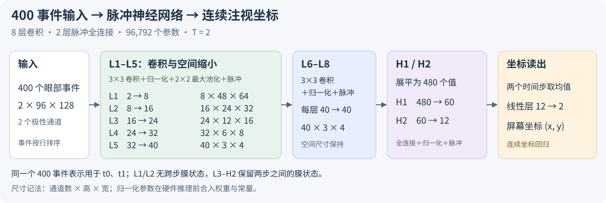

# EBV-Eye SNN Hardware

## 网络结构



400个眼部事件组成2×96×128的双极性计数图，同一张图用于T=2两个时间步。
八层卷积通道为2→8→16→24→32→40→40→40→40，随后480→60→12→2。
共96,792个参数，输出连续屏幕注视坐标。

当前主设计采用L1～L2无状态：这两层完整输出只计算一次，L3卷积结果复用，
L3神经元执行两步；L4～H2逐层连续处理两步。最后把H2两步脉冲取平均，再线性读出。
[设计与数据流](docs/design.md)。

## 软件精度与定点精度

| 范围 | 软件浮点角误差 | 16位定点角误差 |
| --- | ---: | ---: |
| 当前硬件：Pursuit user10、seed2021、1194个test样本 | 0.490071° | 0.506021° |
| Pursuit L1～L2无状态：24用户、25,716个test样本 | 0.823945° | 0.825481° |
| Saccade旧连续输出头L1～L2无状态：24用户、28,389个test样本 | 1.325509° | 1.326037° |

多用户结果先逐人计算，再对24人等权平均。user10按本组seed2021浮点test误差最低选取；
各人的训练轮次按validation选取。完整量化参数、预测和结果均随仓库保存。
[四版本完整结果](docs/results.md)。

## 当前FPGA实现

目标为AUP-ZU3的XCZU3EG，Vivado 2025.2.1。四组分别训练的模型使用相同位宽、
计算阵列和接口，均完成布局布线并通过160 MHz建立、保持和脉宽时序检查。
每组16个相同验证输入的电路功能核验与输入活动功耗评估已完成。

| 版本 | 核心拍数 | 核心时间 | BRAM36等效 | 推理总功率估算 | 每样本总能量估算 |
| --- | ---: | ---: | ---: | ---: | ---: |
| 全有状态 | 105,305 | 0.658156 ms | 170.5 | 0.611188 W | 402.257 µJ |
| 仅L1无状态 | 90,525 | 0.565781 ms | 132.5 | 0.586062 W | 331.583 µJ |
| L1～L2无状态，主设计 | 78,817 | 0.492606 ms | 122 | 0.579625 W | 285.527 µJ |
| L1～L3无状态 | 72,101 | 0.450631 ms | 120 | 0.573000 W | 258.212 µJ |

主设计相对全状态：核心时间减少25.15%，片上块存储减少28.45%，推理总能量减少29.02%。
功耗采用user10各组权重、相同16输入、布线后功能电路活动、25°C典型工艺与标称电压。
时间和能量覆盖输入已装入片上的计算窗口；输入传输另计。上板验证留给期刊扩展。

| 主设计资源 | 使用数 / 器件总量 | 占用比例 |
| --- | ---: | ---: |
| LUT，逻辑单元 | 29,546 / 70,560 | 41.87% |
| FF，寄存器位 | 17,113 / 141,120 | 12.13% |
| DSP，专用计算块 | 308 / 360 | 85.56% |
| BRAM，36Kb等效块 | 122 / 216 | 56.48% |

主设计核心串行处理能力约2030样本/秒；当前评估接口加载一个输入图另需0.3072 ms。
[原始总表](results/summary.json)、[论文CSV表](results/paper_metrics.csv)、
[资源与时序原报告](results/implementation/l1_l2_stateless/reports/)。

## 与眼动硬件工作的比较

| 工作 | 平台与输出 | 时间或吞吐 | 功率 | 每次能量 | 验证阶段 |
| --- | --- | --- | ---: | ---: | --- |
| 本项目L1～L2无状态 | XCZU3EG，连续注视坐标 | 0.493 ms核心，约2030次/秒 | 0.580 W | 285.5 µJ | 布局布线、完整时序、输入活动估算 |
| [Tan 2025](https://doi.org/10.1109/TCSI.2025.3553497) | 40nm ASIC，连续注视坐标 | 1252 FPS | 15.2 mW | 12.7 µJ | 芯片实测 |
| [SEE-D 2024](https://arxiv.org/html/2404.14279v1#S4.T2) | ZCU102＋Arm，眼中心 | 0.70 ms | 3.86 W | 原文2.29 mJ | FPGA系统 |
| [SEE-C 2024，同一论文](https://arxiv.org/html/2404.14279v1#S4.T2) | ZCU102＋Arm，眼中心 | 0.60 ms | 3.86 W | 原文1.88 mJ | FPGA系统 |
| [NeuroEye 2025](https://doi.org/10.1109/ISCAS56072.2025.11043272) | 40nm ASIC，SNN眼动计算 | 12,200 FPS吞吐 | 54.59 mW | 4.47 µJ | 布局布线后评估 |
| [Retina 2024](https://openaccess.thecvf.com/content/CVPR2024W/AI4Streaming/html/Bonazzi_Retina__Low-Power_Eye_Tracking_with_Event_Camera_and_Spiking_CVPRW_2024_paper.html) | Speck，瞳孔位置 | 固定窗5.57 ms | 2.89 mW | 按功率×延迟16.10 µJ | 传感器与处理器实测 |

Tan量化平均/最佳用户误差为1.15°/0.91°，Table III采用最佳用户值。
平台、输出、输入窗口和功耗范围分别保留各论文定义。
16篇外部工作的详细统计与原文来源见[文献比较](docs/related_work.md)。

## 保留的稀疏设计对照

L1/L2脉冲驱动的旧设计只保留[设计、指标与稠密版比较](docs/sparse_comparison.md)。
其代码、旧模型、仿真与实现产物已从当前工作树清理。原提交4430141可追溯历史。
同模型16样本浅层比较显示：旧稀疏前端平均49,307.7拍，独立稠密L1/L2合计26,112拍；
稀疏前端存在平均27,306.8拍的层间等待。

## 独立使用

本仓库包含所需电路、模型、量化工具、测试输入和所有论文取数证据，不依赖相邻软件目录。

```bash
# 已有结果取数，不运行推理、仿真或综合
python scripts/verify.py
python scripts/report.py --output runs/paper_metrics.csv

# 完整检查压缩证据可无损还原
python scripts/verify.py --full

# 可选：重放RTL，需Vivado和NumPy
source /opt/amd/2025.2.1/Vivado/settings64.sh
python scripts/replay.py --variant l1_l2_stateless --samples 0 --output-dir runs/rtl_check
```

量化与模型重算使用Python 3.11、NumPy、PyTorch和Sinabs，依赖见[requirements.txt](requirements.txt)；
FPGA仿真/实现使用Vivado 2025.2.1。完整命令见[复现说明](docs/reproduction.md)。
已有检查点、64份活动与报告可直接读取，论文取数无需重跑。

## 项目结构

```text
hardware/       当前电路、量化参考、FPGA约束与流程
models/         四份训练权重、定点参数和硬件权重镜像
fixtures/       64次验证的参考数组及user10测试输入
results/        量化、RTL、综合、实现、功耗和论文表
scripts/        核验、回放、量化、活动捕获、功耗与表格导出
tests/          独立整数参考与测试输入完整性检查
docs/           当前设计、结果、稀疏对照、文献比较与复现说明
```

原始大数据集和全部训练端点继续在软件侧保存。新运行输出写入本仓库的runs/，
与已确认的results/证据分开。详细证据保存范围见[results/README.md](results/README.md)。
