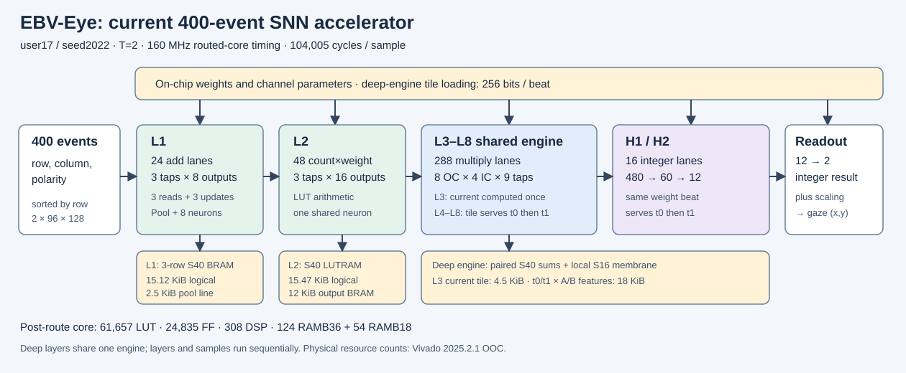

# EBV-Eye SNN Hardware

当前交付版本：Pursuit user17/seed2022，2026-10-16。

加速器接收一个样本的 400 个排序事件，依次完成八层卷积、两个脉冲全连接层和连续坐标读出。权重和中间数据保存在 FPGA 片上。当前实现已完成整网功能验证及 AUP-ZU3 对应器件的核心布局布线。

| 指标 | 当前结果 | 来源 |
|---|---:|---|
| 定点 test 平均角误差 | 0.488592°，1,364 个样本 | user17 软件量化 |
| 整网检查 | 159,408 个值，零失配 | Vivado XSim |
| 样本周期 | 104,005 拍 | 整网仿真 |
| 核心频率 | 160 MHz | 已布线核心时序复核 |
| 核心处理时间 | 0.65003125 ms | 周期 / 频率 |
| 连续串行处理能力 | 约 1,538 样本/秒 | 按当前样本周期换算 |
| LUT / FF | 61,657 / 24,835 | 布线后统计 |
| DSP / BRAM36 等效 | 308 / 151 | 布线后统计 |
| 片上功率估算 | 1.835 W | Vivado，无真实活动文件 |
| 每次推理能量估算 | 约 1.193 mJ | 工具功率 × 核心处理时间 |

时间覆盖权重装载完成后的加速器核心；相机采集、事件成窗与排序、处理器传输及板级接口留待系统集成。当前已完成核心实现，板上推理和功率测量尚待完成。

## 阅读顺序

1. [当前设计与逐层数据流](docs/hardware/current_design.md)。
2. [与 Tan 和 FPGA 眼动追踪工作的性能比较](docs/hardware/comparison.md)。
3. [机器证据与来源](evidence/README.md)、[本次验证](VALIDATION.md)。
4. [早期实现记录](docs/history/pre_vivado_20261013.md)和[本机 Vivado 优化过程](docs/history/vivado_development_20261015.md)。



## 复现当前整网

在仓库根目录，启用 Vivado 2025.2.1 后运行：

```bash
source /opt/amd/2025.2.1/Vivado/settings64.sh
python -B scripts/verify_evidence.py
python -B scripts/replay_current.py --output-dir build/replay
```

回放入口只使用 Python 标准库和 Vivado 自带的 xvlog、xelab、xsim。它检查随仓库提供的真实样本、参数和逐层标准结果，预期得到 104,005 拍、159,408 个值零失配。输出目录使用新的空路径。

重新执行核心综合、布局和布线：

```bash
bash code/hardware/vivado/run_sparse_ooc.sh build/route160 sparse_lm_a
```

该入口默认 6.250 ns，即 160 MHz。详细参数见 [Vivado 入口](code/hardware/vivado/README.md)。已归档的时序证据来自 200 MHz 目标下布线后，在相同布线结果上覆盖为 160 MHz 的时序复核。

检查仓库文件：

```bash
sha256sum -c MANIFEST.sha256
```

## 目录

| 位置 | 内容 |
|---|---|
| code/hardware/rtl/ | 当前硬件描述、单元测试和历史基线 |
| code/hardware/vivado/ | 器件相关综合、实现与时序脚本 |
| code/hardware/*.py | 定点参考和数值验证工具 |
| code/pursuit/ | 与硬件语义对应的模型代码 |
| scripts/ | 当前 XSim 回放和资产检查 |
| evidence/current/ | user17 标准向量、权重、量化、仿真、布线报告 |
| evidence/formal_quantization/ | 48 模型正式量化结果 |
| evidence/rtl_three_route/ | user15 早期三路线对照 |
| docs/hardware/ | 当前设计和外部比较 |
| docs/history/ | 两篇保留的历史阶段记录 |

本次整理用当前 user17 资产替换旧 user15 回放资产，合并重复设计说明，并移除旧架构图及其生成器。早期完整版本可从 Git 提交 3fef30e 恢复。

