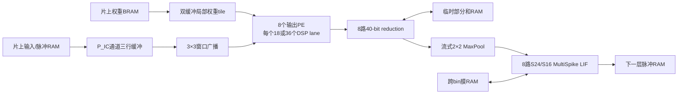

# Pursuit定点参考与并行卷积核心

## 当前结论

首版硬件路线已从“全模型串行计算”收敛为参数化并行共享核心。早期评估了
`P_OC/P_IC/P_K=8/2/9`和`8/4/9`，也就是8个输出PE、每PE 18或36条
乘法lane。冻结的完整顶层选择`8/4/9`：卷积核心有288条并行`U9×S16`
lane，另有16条dense和2条readout lane，整网共映射306个DSP48E2。

下表是完整顶层之前的L1校准估计，保留用于解释架构选择：

| 核心 | FS-TM/SL-TM | SL-HYB | 当前用途 |
|---|---:|---:|---|
| 8 PE×18 lane，144 DSP | 1.003 ms | 0.700 ms | 布线/时序回退 |
| 8 PE×36 lane，288 DSP | 0.595 ms | 0.413 ms | 首选速度点 |

这些是当时的实现前周期估计。现在完整RTL的FS-TM/SL-TM为119,791拍，
SL-HYB为83,286拍；若200 MHz成立，对应0.598955/0.416430 ms，与估计相差
不到1%。L1～L8、H1、H2、readout、跨输入tile部分和、全部RAM和三条控制
路径均已逐值回放。完整结果与Vivado入口见
[04文档](04_pursuit_complete_pre_vivado_rtl.md)。仍缺Vivado时序、布局布线、
器件功率和上板结果。

## 位精确定点合同

当前基线只用validation选择配置，test在配置冻结后运行一次：

- 输入计数：无符号9 bit；每个样本总计400个事件；
- 中间MultiSpike：无符号8 bit；
- 卷积、H1和H2权重：有符号16 bit；readout权重有符号16 bit；
- 每个输出通道使用独立的2的幂scale，最多15个小数位；
- BN和可学习阈值折叠进权重及常量；折叠常量和完整dot product输出为
  有符号24 bit；
- PE内部以及跨输入通道tile的部分和至少需要33个有符号bit，当前RTL使用
  40 bit，DSP48内部可保留48 bit；
- 膜状态为有符号16 bit；
- 静态参数使用nearest、ties away from zero；
- `alpha=0.75`精确实现为`floor(3*v/4)`；
- `spike=min(floor(max(pre_reset,0)/2^F),255)`；
- 减阈值复位后，将膜下限钳制到`-2^F`；
- dot product内部不饱和，只在完整dot product加折叠常量后统一钳制到S24。

逐输出通道scale并不意味着每个通道使用不同数据位宽。8个PE的数据口仍是
统一S16/S24/S16，通道只附带一个小的`fraction_bits`配置。这样保留逐通道
动态范围，又不会破坏规则打包和RAM接口。

## 定点正确性

表中浮点端点是同一脚本、同一CPU Sinabs后端的参考，不能替代论文中正式
Exodus的`0.758±0.016°`端点。

| split | CPU浮点角误差 | 定点角误差 | 定点－浮点 |
|---|---:|---:|---:|
| train物理来源窗 | 0.393±0.007° | 0.392±0.009° | -0.001±0.003° |
| validation | 0.747±0.023° | 0.750±0.012° | +0.003±0.014° |
| test | 0.760±0.016° | 0.767±0.021° | +0.007±0.006° |

三seed的train、validation和test共9次完整扫描中，S24电流饱和值和U8脉冲
饱和值均为0。最大完整dot product绝对值为5,045,700，来自train；最大脉冲
为173，也来自train。没有脉冲饱和时，减阈值后的膜严格位于
`[-2^F,2^F)`，所以最大`F=15`时恰好落入S16。

seed2022另导出16个均匀覆盖validation的样本，包含：

- 完整量化参数`parameters.npz`；
- 输入、target、浮点/定点预测及每层`t0/t1`电流、脉冲和膜状态
  `vectors.npz`；
- 105个可由`$readmemh`读取的参数或单样本回放`.mem`文件；
- checkpoint、configuration、cache、生成器及每个产物的SHA-256 manifest。

## 核心dataflow



卷积循环顺序为：

```text
for timestep:
  for layer:
    for oc_tile in groups of 8:
      for ic_tile in groups of P_IC:
        load 8×P_IC×3×3 weights into local double buffer
        scan (H+2)×(W+2) padded raster through line buffers
        read/update one 8-wide partial-sum vector each cycle
      stream the final ic_tile directly into MaxPool and LIF
```

这同时实现四种复用：整网权重驻留片上，当前权重tile驻留PE近端，重叠输入
窗口驻留三行缓冲，输出部分和驻留寄存器/临时RAM。每拍只需从激活RAM取
`P_IC`个新位置；3×3的其余位置来自行缓冲。当前权重tile在整次空间扫描中
复用，因此不要求BRAM每拍提供2,304或4,608 bit权重。

L1只有2个输入通道，不需要跨输入tile部分和RAM。最大片上部分和来自L2，
8×48×64×40 bit，即120 KiB。H1/H2每个权重只使用一次，以16个S16权重/
拍的有限总线流入并只启用相应lane；H1/H2在整网计算中占比很小，无需为它们
建立288路权重bank。

## 时间组织

FS-TM和SL-TM都先完整执行`t0`再执行`t1`。两者算术和控制完全相同：FS在
两步之间保存L1～H2的45,000个膜元素，SL只保存L3～H2的8,136个元素。
这样72 KiB逻辑状态差可直接对应物理膜RAM差。

SL-HYB建立在SL之上。重复完整输入且L1/L2无状态，使两步L3 Pool后电流完全
相同：硬件只计算一次L1～L3卷积和Pool，缓存4,608个S24 L3电流，再分别同
L3的`t0`和`t1`膜执行两次LIF。周期模型额外计入第二次读取L3缓存的576拍，
没有把LIF回放当成零成本。

FireFly v2式层内两时间步调度仍可在主对照完成后评估。它会把膜状态留在当前
层局部寄存器中，弱化45,000对8,136状态的物理RAM对比，所以不作为论文的
主公平调度。

## 周期与存储估计

周期模型使用256-bit权重装载总线，即16个S16权重/拍；每次空间扫描计
`(H+2)×(W+2)`拍并加14拍流水线开销。14拍来自完整L1 RTL实测：3,072个
Pool后输出向量从`start`到`done`共12,754拍，恰为`98×130+14`。下表同时给
完全串行权重装载和双缓冲隐藏后续tile装载的边界：

| 配置 | 调度 | FS/SL周期 | SL-HYB周期 | 100 MHz FS/SL / HYB | 200 MHz FS/SL / HYB |
|---|---|---:|---:|---:|---:|
| 144 DSP | 串行装载 | 200,602 | 140,063 | 2.006 / 1.401 ms | 1.003 / 0.700 ms |
| 144 DSP | 双缓冲 | 192,448 | 132,179 | 1.924 / 1.322 ms | 0.962 / 0.661 ms |
| 288 DSP | 串行装载 | 119,050 | 82,543 | 1.191 / 0.825 ms | 0.595 / 0.413 ms |
| 288 DSP | 双缓冲 | 111,022 | 74,767 | 1.110 / 0.748 ms | 0.555 / 0.374 ms |

按当前位宽并加入40-bit临时部分和、行缓冲、局部双权重tile和Pool行状态，
未计BRAM碎片的容量为：

| 配置 | FS-TM | SL-TM | SL-HYB |
|---|---:|---:|---:|
| 144 DSP | 451.57 KiB | 379.57 KiB | 393.07 KiB |
| 288 DSP | 452.13 KiB | 380.13 KiB | 393.63 KiB |

两配置的容量几乎相同；差别只来自更大的局部双权重tile。SL-HYB的L3 S24
电流缓存为13.5 KiB。以上总量低于XCZU3EG的216块BRAM36原始容量，但
端口宽度、深度拼接、PS接口和控制缓冲仍会产生碎片，必须由Vivado报告确认。

## 已完成RTL及开源映射

已实现并通过Icarus行为仿真和Verilator `--Wall` lint：

- `synapse_count_mac_array.sv`：U9计数×S16权重，8路S40归约；
- `synapse_unary_add_array.sv`：每个enable发放一次权重加法；
- `synapse_shift_add_array.sv`：每lane每拍发放一个二进制移位项，计数`n`需要
  `popcount(n)`次issue，未隐藏9套组合加法器；
- `pipelined_count_mac_array.sv`：DSP乘积寄存、逐层平衡归约流水、部分和与
  地址tag等长延迟，每拍可接收一个独立输出位置；18/36 lane的流水深度分别
  为6/7拍；完整扫描模型按L1闭环测得的14拍总填充/排空开销计入；
- `padded_line_buffer_3x3.sv`与`maxpool2x2_stream.sv`：同步读优先RAM，连续
  接收padded raster并维持每拍一个窗口/电流向量；
- `l1_streaming_layer.sv`：同步输入RAM地址生成、2×96×128输入、8路完整
  3×3卷积、S24钳制、2×2 MaxPool和无状态LIF闭环；
- `lif_multispike.sv`：S24电流、S16膜、逐通道fraction bits、floor leak、
  U8 MultiSpike和显式`range_error`；
- 四个自检testbench覆盖有符号负权重、计数乘法与移位项等价、负数floor、
  多脉冲、膜下限、脉冲溢出标志和完整L1正式样本回放。

Yosys 0.69的`xcup` primitive mapping结果如下。端口未插入IO buffer；结果
没有placement、routing、Fmax或功率含义。

| 微核 | DSP48E2 | CARRY4 | LUT映射 | 解释 |
|---|---:|---:|---:|---|
| 8×18计数乘法 | 144 | 1,440 | 5,760 LUT2 | 144-DSP回退点 |
| 8×36计数乘法 | 288 | 2,880 | 11,520 LUT2 | 288-DSP速度点 |
| 8×18流水计数乘法 | 144 | 1,128 | 4,337 LUT2；11,255 FF | 可每拍接收新窗口 |
| 8×36流水计数乘法 | 288 | 2,232 | 8,569 LUT2；20,472 FF | 当前速度核心RTL |
| 8×18逐单位加法 | 0 | 1,440 | 8,064 LUT2 | 每个计数需`n`次issue |
| 8×18单bit移位项 | 0 | 1,440 | 各类LUT合计14,724 | 每个计数需`popcount(n)`次issue |
| 完整L1流式层 | 144 | 1,580 | 各类LUT合计8,634；15,285 FF；3 RAMB36+2 RAMB18 | 含RAM接口、行缓冲、Pool、LIF和控制 |

完整L1使用seed2022 validation样本0回放，逐位检查3,072个空间地址×8通道的
S24 Pool后电流、U8脉冲和S16膜，共73,728个值，零失配且无`range_error`。
最初异步行存储的Yosys映射为44,300 FF、0 BRAM；改成同步宽RAM后降为
15,285 FF并映射出3 RAMB36+2 RAMB18。这个差异说明RAM端口语义必须在
Vivado前固定，不能只按bit容量估算。

这解释了为什么“乘法在数学上可删”不等于“FPGA主核心应删DSP”。AUP-ZU3有
专用DSP，而LUT和路由还要承担控制、RAM地址、Pool、LIF与AXI；用大量LUT
复制加法/移位网络会侵占更紧张的通用资源。首版稠密基线使用DSP规则核心；
此后已实现L1事件add-only、L2 count-MAC稀疏前端并接入两套整网顶层，见05报告。

## 复现入口与证据边界

- 定点评估：`code/hardware/evaluate_pursuit_fixed_point.py`；
- golden生成：`code/hardware/generate_pursuit_golden_vectors.py`；
- 实现前周期模型：`code/hardware/estimate_pursuit_rtl_schedule.py`；
- RTL统一检查：`code/hardware/run_rtl_checks.py`；
- 完整L1正式回放：`code/hardware/run_l1_golden_check.py`；
- 整网回放：`code/hardware/run_full_accelerator_golden_check.py`；
- 参数镜像打包：`code/hardware/pack_pursuit_hardware_image.py`；
- RTL：`code/hardware/rtl/`；
- 三seed全split定点JSON：
  `/data/xuzx/result/ebv-eye/pursuit/fixed_event_window/hardware/fixed_point_reference_20261006/`；
- golden vectors：
  `/data/xuzx/result/ebv-eye/pursuit/fixed_event_window/hardware/golden_vectors_seed2022_20261006/`；
- 周期/存储JSON：
  `/data/xuzx/result/ebv-eye/pursuit/fixed_event_window/hardware/rtl_schedule_estimate_l1calibrated_20261006.json`；
- 仿真、lint和primitive mapping：
  `/data/xuzx/result/ebv-eye/pursuit/fixed_event_window/hardware/rtl_microkernels_open_source_20261006/`；
- 含流水计数核心的完整开源检查：
  `/data/xuzx/result/ebv-eye/pursuit/fixed_event_window/hardware/rtl_core_open_source_20261006/`。
- 完整L1正式golden回放、lint与primitive mapping：
  `/data/xuzx/result/ebv-eye/pursuit/fixed_event_window/hardware/rtl_l1_streaming_golden_20261006/`。
- 整网三dataflow回放、lean/full lint与primitive mapping：
  `/data/xuzx/result/ebv-eye/pursuit/fixed_event_window/hardware/rtl_full_accelerator_pre_vivado_20261006/`。

器件相关下一步是在Vivado中对`xczu3eg-sfvc784-2-e`运行稠密lean/full及05报告
中的Sparse-TM/Sparse-LM-A OOC构建，锁定200 MHz是否成立、实际BRAM碎片及
拥塞。实体板卡只在后续PS/AXI封装、真实输入回放和板级功率阶段需要。
